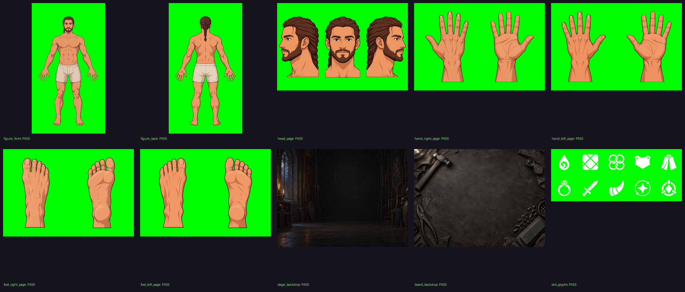
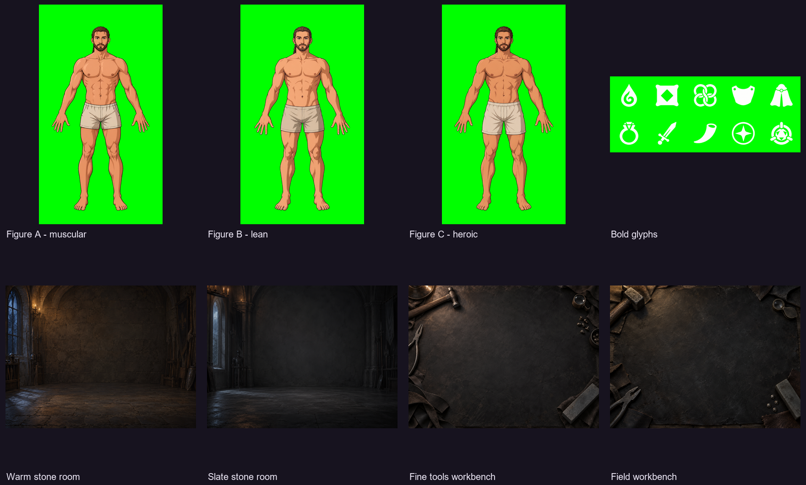
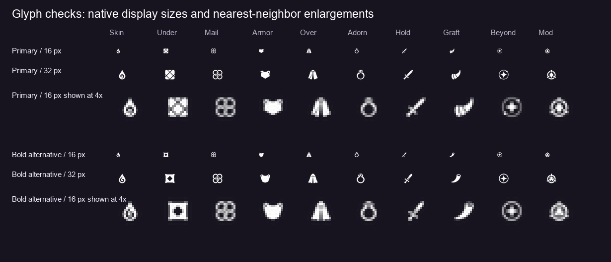

# Equipment art delivery - 25 October 2026

This package supplies the ten phase-1 equipment images at the exact paths in
[the upstream checklist](art-handoff-equipment.md), plus eight optional alternatives.
The primary set passes the unchanged upstream checker: **10 of 10 pass**.

Base: `prototype/progression` at `1d3cee294c6e7f8281d71da75795b2973f5e3b43`.
Delivery branch: `art/equipment-phase1-20261025`.

## Start here



Use the ten PNGs directly in `art/equipment/` as the coordinated primary set.
The front, back and close-ups share the selected figure identity. The alternative
front figures are design options, not interchangeable members of this set.

| File in art/equipment/ | Canvas | Content |
| --- | --- | --- |
| figure_front.png | 2160 x 3840 | Front master, candidate D |
| figure_back.png | 2160 x 3840 | Matching back, palms facing the viewer |
| head_page.png | 3520 x 2352 | Right profile / front / left profile |
| hand_right_page.png | 3520 x 2352 | Back / palm; thumbs left / right |
| hand_left_page.png | 3520 x 2352 | Back / palm; thumbs right / left |
| foot_right_page.png | 3520 x 2352 | Top / sole; big toes left / right |
| foot_left_page.png | 3520 x 2352 | Top / sole; big toes right / left |
| stage_backdrop.png | 2560 x 1920 | Dim moonlit stone fitting room |
| board_backdrop.png | 2560 x 1920 | Neutral charcoal leather workbench |
| slot_glyphs.png | 2560 x 1024 | Ten white glyphs, 5 columns by 2 rows |

All images are 8-bit RGB PNGs with an sRGB chunk. Figure pages and glyphs use
flat pure green `#00ff00`; backdrops are opaque. There is no baked-in UI or text.
The grid order is Skin, Under, Mail, Armor, Over, Adorn, Hold, Graft, Beyond, Mod.
Each glyph is centered in its 512 px cell with a maximum extent of 307 px.

## Alternatives



Paths below are relative to `art/equipment/variants/`. Every alternative passes
the matching individual check. These are optional choices, not extra required files.

| Path | Selection note |
| --- | --- |
| figure-a/figure_front.png | Stronger muscular definition and shorter braies; front-only concept |
| figure-b/figure_front.png | Leaner silhouette and angular anatomical planes; front-only concept |
| figure-c/figure_front.png | More pronounced heroic anatomy; front-only concept |
| warm-stone/stage_backdrop.png | Warmer rustic stone room; more visible masonry |
| slate-stone/stage_backdrop.png | Cooler, quieter room with a smoother central wall |
| fine-tools/board_backdrop.png | Smaller tools and a more open center |
| field-bench/board_backdrop.png | Rugged mat, heavier hammer and sparse corner tools |
| bold-glyphs/slot_glyphs.png | Rounder, heavier shapes; simplified cloth and horn details |

Backdrop and glyph alternatives can replace the corresponding primary file
before import, keeping its filename. Run the full checker again after selection.
If selecting another front figure, regenerate its back and close-ups from that
figure and approve the complete set before mapping. Do not mix identities or
assume an alternative has the primary figure's pixel coordinates.

## Generation and resolution

Created with Codex's built-in `image_gen` workflow. The built-in tool does not
expose a model identifier or seed, so this delivery does not claim a verified API
model version. The requested production sizes and highest-quality instructions,
verbatim upstream prompts, appended corrections and reference relationships are
recorded in [prompts.json](../art/equipment/prompts.json).

The tool returned smaller native rasters: figures at 941 x 1672, head/foot pages
at 1536 x 1024, hand pages at 1535 x 1025, backdrops at 1448 x 1086, and glyph sheets
at 1983 x 793. Final PNGs are resized to the required canvases; they are **not
native 4K renders**. Extra canvas pixels do not create additional native detail.
Review the intended deepest zoom before approving production mapping.

[prepare_equipment_delivery.py](../tools/prepare_equipment_delivery.py) performs
only uniform scaling, positioning and flat green-key cleanup. It does not paint
anatomy, mirror a body part, stretch a silhouette or alter the checker. All views
within each close-up page use the same scale. The head views are approximately
1630 px tall to retain clear gutters; hand and foot views are about 1900 px tall.
The original generated rasters are archived locally; they are not duplicated in
this branch. Their SHA-256 values and native dimensions are in the prompt record.
The fitting utility accepts a JSON list of source, destination, kind, size and
optional views fields, as described in its module documentation.

The requested three-step material ramps guide the illustrations. Generated
rasters retain antialiasing and some intra-tone variation; no strict indexed
palette reduction is claimed. Apply the project's palette normalization at import
if exact per-material swatches are required, while preserving all coordinates.

## Validation

Run from the repository root with Python 3, Pillow and NumPy:

```sh
python3 tools/equipment_art.py check
python3 tools/equipment_art.py sheet
```

On the Windows authoring machine the Python 3 executable is named `python`; the
same unchanged script was run with that executable. Full output is saved in
[validation.txt](../art/equipment/validation.txt). A structured summary and file
hashes are in [delivery.json](../art/equipment/delivery.json).

- Primary set: 10 of 10 pass.
- Optional alternatives: 8 of 8 pass their relevant individual checks.
- Front/back silhouette overlap: approximately 96%, above the 85% threshold.
- Front/back mirror symmetry: approximately 98% / 99%.
- Primary background saturation: approximately 21% for the room, 19% for the bench.
- Figure and close-up borders are completely green; no measured interior green spill.
- Visual review covered view order, fingers and toes, exposed ears, the single braid,
  clothing, isolated silhouettes, blank center space and the absence of writing.
- Checker source is unchanged. No gameplay regression, slot mapping or runtime
  integration is represented by these art checks.



Automated checks do not certify anatomy, exact material palettes or native image
detail. The previews and documented resolution limitations remain part of review.
The bolder glyph alternative simplifies the stitched cloth motif; use the primary
sheet when the literal quilt pattern matters more than small-size simplicity.

## Integration handoff

1. Approve the coordinated primary figure set and choose backdrop/glyph options.
2. Import into `assets/equipment/`, keying out `#00ff00` and cleaning antialiased
   edge spill. Keep the full canvases and the documented pixel coordinates.
3. Map the body regions and 328 body slots once on the approved canvases. Preserve
   this framing for future equipment overlays. Keep this delivery commit as the
   mapping baseline.
4. Implement zoom transitions and the front/back turn using these exact masters.
5. Request phase-2 worn-piece masks only after the mapping is approved.

The `art/` directory remains excluded from Godot import. This delivery provides
source art, not already-wired runtime textures. No player saves, localization
files, game code or workflow definitions are part of the change.

All newly delivered paths, documentation, prompt records, validation reports and
commit text are English/ASCII. Images were visually checked for writing and contain
no Chinese text. Existing upstream files are not rewritten for this delivery.
